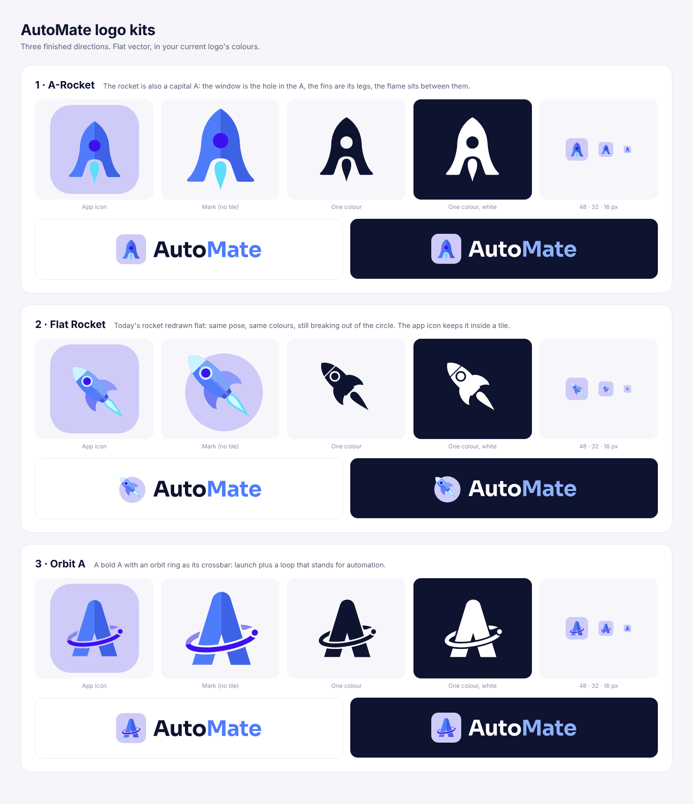

# AutoMate logo kits

Three finished directions for the AutoMate logo. All are flat vector, in the colours of the current AutoMate logo.



| Folder | Idea |
| --- | --- |
| `automate/1-a-rocket/` | The rocket is also a capital A. The window is the hole in the A, the fins are its legs, and the flame sits between them. |
| `automate/2-flat-rocket/` | Today's rocket redrawn flat. Same pose and colours, still breaking out of the circle. |
| `automate/3-orbit-a/` | A bold A with an orbit ring as its crossbar: launch, plus a loop for automation. |

## Files in each folder

| File | Use |
| --- | --- |
| `icon.svg` | App icon on a rounded tile: favicons, app stores, social avatars |
| `mark.svg` | Symbol without the tile, for placing on your own backgrounds |
| `logo-on-light.svg` | Icon + name, for light backgrounds |
| `logo-on-dark.svg` | Icon + name, for dark backgrounds |
| `mono-ink.svg` / `mono-white.svg` | One-colour symbol (print, stamps, watermarks, single-colour UI) |
| `favicon.ico` | 16, 32 and 48 px favicon |
| `png/icon-*.png` | App icon at 16, 32, 48, 192, 512 and 1024 px (transparent corners) |
| `png/apple-touch-icon.png` | 180 px full-bleed square for iOS, which rounds the corners itself |
| `png/mark-1024.png` | Symbol without the tile, 1024 px |
| `png/logo-on-light@2x.png` / `png/logo-on-dark@2x.png` | Name lockups at 2x, transparent background |

Favicon tags for a website:

```html
<link rel="icon" href="/favicon.ico" sizes="48x48">
<link rel="icon" href="/icon.svg" type="image/svg+xml">
<link rel="apple-touch-icon" href="/apple-touch-icon.png">
```

## Colours

Sampled from the current AutoMate logo and flattened to solid fills (no gradients).

| Token | Hex | Used for |
| --- | --- | --- |
| Lavender | `#CFCBF8` | Icon tile and circle background |
| Blue | `#4F7CFB` | Main symbol colour, "Mate" in the name |
| Blue, shade | `#3E62E6` | Shaded half of the A-Rocket and Orbit A |
| Blue, light | `#7CA4FA` | Lit half of the Flat Rocket body |
| Violet | `#3D10F0` | Rocket window, orbit ring |
| Violet, soft | `#8D86F0` | Back half of the orbit ring |
| Periwinkle | `#8D99FB` / `#6F7BF2` | Flat Rocket fins |
| Cyan | `#5FDDFB` | Flame |
| Ice | `#C9F3FF` | Flat Rocket nose cone and window ring |
| Ink | `#0E1330` | "Auto" on light backgrounds, one-colour logo |
| Blue on dark | `#8DB1FF` | "Mate" on dark backgrounds |

## Typeface

The name is set in **Sora Bold** with "Auto" and "Mate" in two colours. It is converted to outlines, so the logo files need no font installed. Sora is free to use under the SIL Open Font License; install it from Google Fonts to set matching text.

## Usage

- Keep clear space around the logo equal to half the icon's height.
- Use `logo-on-light` on white or light UI, and `logo-on-dark` on dark UI.
- Don't show the icon smaller than 16 px, or the name lockup narrower than 120 px.
- Don't recolour, stretch, rotate, add shadows to, or put gradients on the logo.
